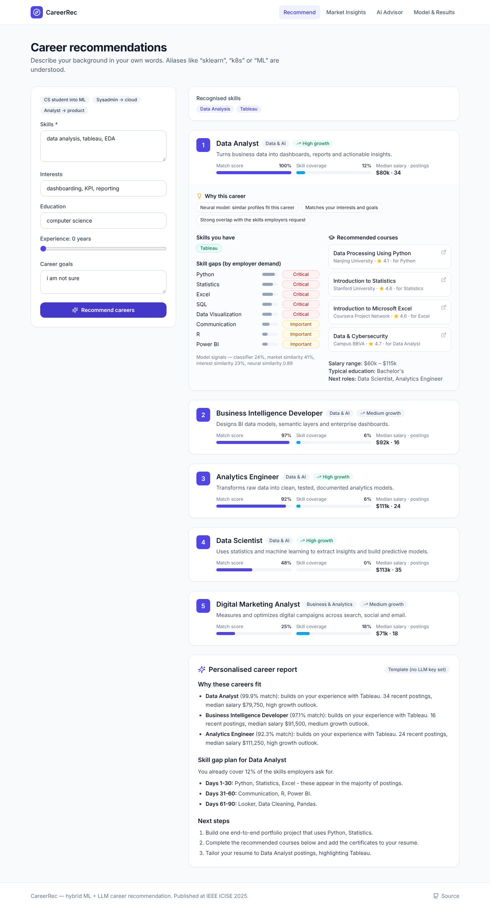
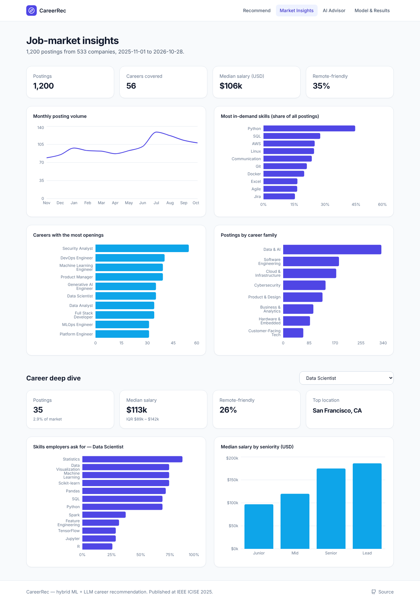
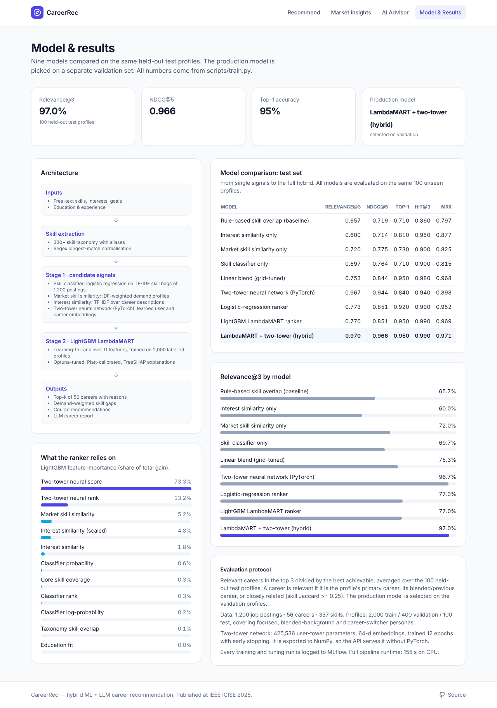

# CareerRec: AI Career Recommendation System

[](https://github.com/meetkothari-08/CareerRecommendation/actions/workflows/ci.yml)


> **Published at IEEE ICISE 2025** · [Paper](#citation)

CareerRec recommends career paths by combining **machine learning over job-posting data**, a
**two-tower deep-learning model**, **learning-to-rank** and a **fine-tuned LLM**. It reads a free-text
profile (skills, interests, education, goals) and returns:

- the best-fitting careers out of **56 career paths**, with calibrated match scores and the reasons behind them,
- a **skill-gap analysis** that ranks missing skills by how often employers ask for them,
- **course recommendations** for those gaps, taken from a Coursera catalogue,
- a **personalised career report** from an LLM, built from the model's own results.

| Metric (100 held-out test profiles) | Score |
|---|---|
| **Recommendation relevance (relevance@3)** | **97.0%** |
| NDCG@5 | 0.966 |
| Top-1 accuracy / Hit@3 | 95% / 99% |
| Stage-1 skill classifier, macro-F1 (240 held-out postings) | 0.956 |
| API latency per recommendation (CPU, incl. skill gaps + courses) | ~10 ms |

The paper reports **86% recommendation relevance across 100 test profiles**. The table above comes from
the synthetic benchmark in this repository and can be reproduced with `python -m scripts.train`. See
[Evaluation](#evaluation) for how it is measured, and [Limitations](#limitations) for how to read it.

<p align="center"></p>

---

## Architecture

```mermaid
flowchart LR
    U[Free-text profile] --> SE[Skill extractor<br/>337-skill taxonomy + aliases]
    J[(1,200 job postings<br/>Adzuna live / snapshot)] --> S1
    SE --> S1
    subgraph S1[Stage 1: candidate signals]
        C[Skill classifier<br/>LogReg on TF-IDF skill bags]
        M[Market skill similarity<br/>IDF-weighted demand profiles]
        I[Interest similarity<br/>TF-IDF over career text]
        N[Two-tower neural network<br/>PyTorch, exported to NumPy]
        K[Taxonomy overlap + education fit]
    end
    S1 --> R[Stage 2: LightGBM LambdaMART<br/>2,000 labelled profiles, calibrated + TreeSHAP]
    R --> G[Skill-gap analysis<br/>demand-weighted priorities]
    G --> CR[Course recommender]
    R --> L[Fine-tuned LLM advisor<br/>grounded prompt]
    G --> L
    L --> O[Ranked careers + gaps + courses + report]
```



**1. Skill extraction** (`careerrec/skills.py`). Free text such as *"python, sklearn, k8s, some ML"* is
mapped to canonical skills with longest-match regex and an alias dictionary. It handles `C++`, `C#`,
`Node.js`, `Objective-C`, and skips ambiguous words like *go* or *excel* when they are used as ordinary words.

**2. Stage 1: candidate signals** (`careerrec/recommender.py`, `careerrec/neural.py`). Each career gets these scores:
- *Skill classifier*: multinomial logistic regression trained on the TF-IDF-weighted skill sets of the job
  postings. It learns which combinations of skills separate one career from another.
- *Market skill similarity*: cosine similarity between the user's skills and each career's demand profile,
  i.e. the share of that career's postings that ask for each skill.
- *Interest similarity*: TF-IDF cosine similarity between the user's interests and goals and each career's description.
- *Knowledge-base priors*: overlap with the taxonomy's skills, coverage of the core skills, and education fit.
- *Two-tower neural network*: a user tower (skill TF-IDF + interest/goal TF-IDF → 256 → 64) and a career
  tower (demand profile + description + learned ID embedding → 64) produce L2-normalised embeddings scored
  by cosine similarity. It is trained in PyTorch with a listwise softmax loss over all 56 careers and soft
  targets (primary career weighted 2, related careers 1). Training uses the labelled profiles plus the job
  postings as skill-only examples with skill dropout. It learns which careers are *related*, which
  per-career features cannot express. After training, the weights are exported to NumPy, so the API
  serves the model with a matrix multiply and no PyTorch dependency.

**3. Stage 2: LightGBM LambdaMART** (`careerrec/rankers.py`). A gradient-boosted learning-to-rank model
that directly optimises NDCG over the 11 stage-1 features. To avoid target leakage, the two-tower scores
for its training rows are **5-fold out-of-fold** predictions. Raw scores are **Platt-calibrated** into the
0–100% match score, and **TreeSHAP** contributions become the "Why this career" reasons shown in the UI.

**Training pipeline** (`scripts/train.py`). **Optuna** tunes the two-tower network (12 trials) and both
LambdaMART variants (25 trials each) on the validation profiles. **MLflow** logs every trial and model
(`make mlflow` opens the UI). The production model is then chosen **on validation, never on test**.
The full run takes about 2.5 minutes on a laptop CPU.

**4. Skill gaps and courses** (`skill_gap.py`, `courses.py`). Missing skills are labelled *Critical*,
*Important* or *Nice to have* according to how often postings ask for them. Courses are matched to the
most important gaps first.

**5. LLM advisor** (`llm.py`, `prompts.py`). The ranked careers, gaps and market statistics are written
into a structured prompt, so the LLM explains results instead of inventing them. Any OpenAI-compatible
endpoint works: Groq, or the LoRA fine-tuned model served by vLLM. If no key is set, a deterministic
template report is used, so the app also runs fully offline.

## Fine-tuned LLM

`backend/finetune/` contains the full fine-tuning pipeline:

1. `build_sft_dataset.py` writes chat-format examples. Each one pairs the **exact prompt used at
   inference time** (profile plus recommender output) with a career report. The reports come from the
   grounded template by default, or from a larger teacher model with `--teacher llm` (distillation).
   A 100-example sample is in `data/finetune/career_advisor_sft.sample.jsonl`.
2. `train_lora.py` runs QLoRA (4-bit NF4, r=16, all attention and MLP projections) with TRL's `SFTTrainer`,
   computing loss on the assistant answers only. A single 16–24 GB GPU is enough for 1–3B models.
3. Serve the adapter with vLLM and point the API at it:

```bash
vllm serve meta-llama/Llama-3.2-3B-Instruct --enable-lora --lora-modules careerrec-advisor=models/careerrec-advisor-lora --port 8001
```

```bash
export LLM_BASE_URL=http://localhost:8001/v1 LLM_MODEL=careerrec-advisor LLM_API_KEY=local
```

## Data

| File | Contents |
|---|---|
| `data/careers.json` | Knowledge base of 56 careers in 8 families: core and secondary skills, interests, salary bands, growth outlook, next roles |
| `data/skill_aliases.json` | About 100 alias groups (`k8s` → Kubernetes, `sklearn` → Scikit-learn, …) |
| `data/job_postings.csv` | 1,200 postings: title, company, location, seniority, salary, date, skills, description |
| `data/courses.csv` | Public Coursera catalogue (988 courses) |
| `data/eval/*.json` | 2,000 training, 400 validation and 100 held-out test profiles with relevance labels |

**Real-time job data.** `scripts/ingest_jobs.py` pulls current postings for every career from the
[Adzuna API](https://developer.adzuna.com) and extracts skills from them with the same extractor used
at inference time. Live postings change every day and cannot be redistributed, so the repository ships
a **reproducible synthetic snapshot** with the same schema (`scripts/generate_data.py`, seed 42). The
snapshot is built from the knowledge base and includes realistic noise: generic skills, hybrid roles,
seniority and location-based salaries, and demand trends that follow each career's growth outlook.
To retrain on live data:

```bash
python -m scripts.ingest_jobs --countries us gb in
```

```bash
CAREERREC_POSTINGS=../data/job_postings_live.csv python -m scripts.train
```

## Evaluation

The 100 test profiles are **never used for training or tuning**, and they are deliberately messy:
partial skill lists, aliases and lower-case spellings, off-target skills, empty interests, and three
personas. *Focused* profiles (55%) fit one career, *blended* profiles (30%) span two related careers,
and *career switchers* (15%) list skills from a previous career while their interests point to a new one.

A recommended career counts as **relevant** if it is the profile's primary career, its blended or
previous career, a natural next role, or a related career. A related career must share transferable
skills (Jaccard ≥ 0.25) **and** overlapping interests.
**Relevance@3** = relevant careers in the top 3 ÷ min(3, number of relevant careers).

| Model | Relevance@3 | NDCG@5 | Top-1 | Hit@3 | MRR |
|---|---|---|---|---|---|
| Rule-based skill overlap (baseline) | 0.657 | 0.719 | 0.710 | 0.860 | 0.797 |
| Interest similarity only | 0.600 | 0.714 | 0.810 | 0.950 | 0.877 |
| Market skill similarity only | 0.720 | 0.775 | 0.730 | 0.900 | 0.825 |
| Skill classifier only | 0.697 | 0.764 | 0.710 | 0.900 | 0.815 |
| Linear blend (grid-tuned) | 0.753 | 0.844 | 0.950 | 0.980 | 0.968 |
| Logistic-regression ranker | 0.773 | 0.851 | 0.920 | 0.990 | 0.952 |
| LightGBM LambdaMART ranker | 0.770 | 0.851 | 0.950 | 0.990 | 0.969 |
| Two-tower neural network (PyTorch) | 0.967 | 0.944 | 0.840 | 0.940 | 0.898 |
| **LambdaMART + two-tower (hybrid, selected)** | **0.970** | **0.966** | **0.950** | **0.990** | **0.971** |

The feature-based rankers are best at picking the **single** best career (top-1 95%). The two-tower
network is best at surfacing **related** careers (relevance@3 96.7%) but weaker at top-1 (84%). The
hybrid gets both, and the two-tower score accounts for about 86% of LambdaMART's split gain. By persona,
relevance@3 is 97.7% for focused, 98.8% for blended and 89.7% for career-switcher profiles.

## Limitations

- **Synthetic benchmark.** Training, validation and test profiles come from the same generator, so the
  neural network can partly learn how that generator relates careers. Expect a smaller gain on real users.
  An early version of the relevance labels counted skill overlap alone. That made Bioinformatics Scientist
  "relevant" to every Data Analyst profile, and the neural network learned the mistake. Requiring shared
  interests fixed it, and every model was re-evaluated on the corrected labels.
- **Coursera catalogue.** The bundled catalogue is mostly free, general-interest courses, so some
  technical skills have no matching course.

<p align="center">
  
  
</p>

## Quick start

Requirements: Python 3.10+ and Node 18+. `make setup` installs the CPU build of PyTorch for training.
The API itself only needs `backend/requirements.txt`, because the trained neural network is served from NumPy.

```bash
make setup
```

```bash
make train
```

```bash
make api
```

Then, in a second terminal:

```bash
make web
```

Open http://localhost:5173. The interactive API docs are at http://localhost:8000/docs.

To get LLM-written reports, copy `.env.example` to `.env`, set `LLM_API_KEY` (a free Groq key works),
and export it before starting the API. Without a key, everything else still works and the report
comes from the offline template.

### API

| Method | Endpoint | Description |
|---|---|---|
| `POST` | `/api/recommend` | Profile → ranked careers, skill gaps, courses, LLM report |
| `GET` | `/api/market/overview` | Demand trend, top skills, top careers, salary stats |
| `GET` | `/api/market/careers/{id}` | Per-career demand, salary by seniority, top skills |
| `POST` | `/api/chat` | Career-advisor chat, optionally grounded in a profile |
| `GET` | `/api/careers` · `/api/metrics` · `/api/health` | Catalogue, evaluation results, status |

```bash
curl -s localhost:8000/api/recommend -H 'Content-Type: application/json' -d '{"skills": "python, sklearn, SQL, pytorch", "interests": "AI products", "education": "B.Tech", "experience_years": 1, "include_advice": false}'
```

## Project structure

```
├── backend/
│   ├── careerrec/          # core library: skills, recommender, neural (two-tower), rankers (LambdaMART),
│   │                       #   skill gap, courses, market, LLM, evaluation, MLflow tracking
│   ├── api/                # FastAPI app + Pydantic schemas
│   ├── scripts/            # generate_data, train (tuning + model selection + evaluation), ingest_jobs (Adzuna)
│   ├── finetune/           # SFT dataset builder + QLoRA training
│   └── tests/              # unit + API tests (pytest)
├── frontend/               # React + TypeScript + Tailwind + Recharts
├── data/                   # knowledge base, postings, courses, evaluation profiles
├── models/                 # metrics.json (trained model is generated by `make train`)
└── .github/workflows/ci.yml
```

## Tech stack

**ML / AI:** PyTorch (two-tower retrieval), LightGBM (LambdaMART learning-to-rank), scikit-learn (logistic regression, TF-IDF), Optuna, MLflow, NumPy, pandas, Hugging Face Transformers, PEFT/QLoRA, TRL, vLLM, Groq (Llama 3) ·
**Backend:** FastAPI, Pydantic, httpx, pytest, Ruff · **Frontend:** React 18, TypeScript, Vite, Tailwind CSS, Recharts · **Ops:** Docker, GitHub Actions

## Citation

If you use this work, please cite the paper (IEEE ICISE 2025):

```
<!-- TODO: add the IEEE Xplore link and BibTeX entry -->
```

## License

MIT
